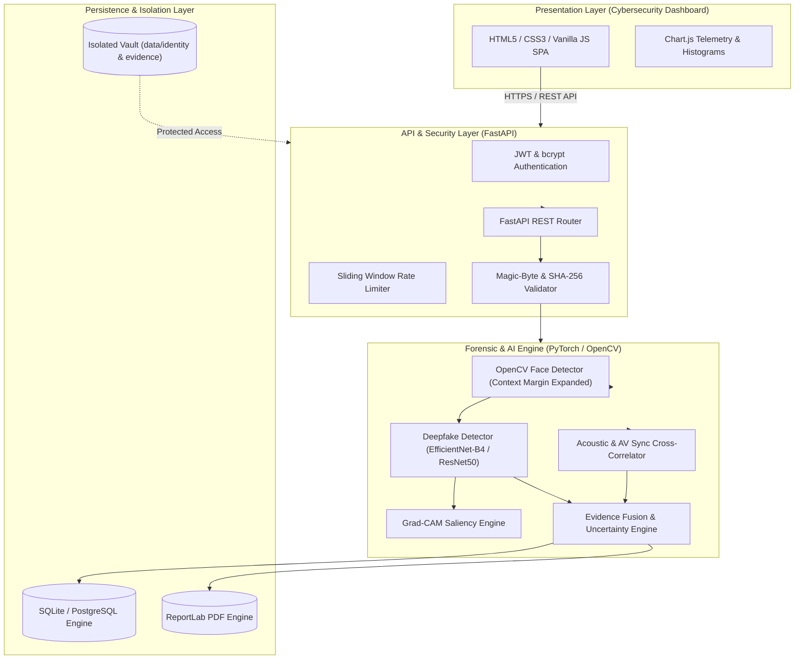

# VERITAS AI — System Architecture Specification

## 1. Executive Summary

VERITAS AI is a forensic platform designed for explainable, multimodal deepfake detection and privacy-preserving digital identity protection. Rather than providing opaque binary classifications ("real" vs. "fake"), VERITAS AI communicates uncertainty, isolates spatial attributions via Grad-CAM, cross-correlates audio-visual synchronization signals, and manages identity misuse through consented biometric reference matching.

---

## 2. Component Architecture

---

## 3. Core Forensic Workflows

### 3.1 Image Forensic Pipeline
1. **Binary Signature Verification:** Validates file magic bytes against JPEG (`\xFF\xD8\xFF`), PNG (`\x89PNG`), and WEBP (`RIFF....WEBP`).
2. **Cryptographic Hashing:** Computes SHA-256 hash across the raw bitstream upon ingestion.
3. **Context-Expanded Face Detection:** Detects facial bounding boxes and applies a 25% margin expansion to preserve forehead, ear, and jawline boundary seams where blending artifacts frequently occur.
4. **PyTorch Inference:** Feeds normalized tensors into EfficientNet-B4 / ResNet50 backbone.
5. **Grad-CAM Explainability:** Hooks into the final convolutional feature layer to compute gradients of the manipulated class logit, yielding spatial saliency overlays.
6. **Uncertainty Categorization:** Evaluates score against Category A ($\ge 0.65$), Category B ($\le 0.35$), or Category C (Inconclusive / Abstention).

### 3.2 Video Temporal Analysis Pipeline
- Uniform temporal sampling across video stream (e.g. 16–24 sample frames) to ensure responsive throughput.
- Per-frame face detection, bounding box normalization, and scoring.
- Temporal aggregation using a weighted combination of mean frame score and peak frame anomaly to capture localized face swaps.
- Asynchronous processing dispatched via `ThreadPoolExecutor` so client receives immediate tracking ID without HTTP connection timeouts.

### 3.3 Privacy-Preserving Identity Likeness Protection
- Requires explicit user consent prior to profile creation.
- Stores reference photograph in `data/identity/` (isolated from public web server directories).
- Extracts L2-normalized biometric embedding vector.
- Computes Cosine Similarity $\cos(\theta) = \frac{\mathbf{u} \cdot \mathbf{v}}{\|\mathbf{u}\|\|\mathbf{v}\|}$ against primary detected faces in scanned media.
- Provides immediate deletion controls to purge biometrics and reference photos.
